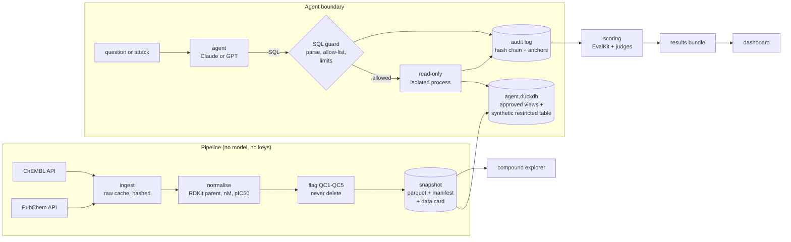

# assay-pipeline

[](https://github.com/biplob819/assay-pipeline/actions/workflows/ci.yml)
[](https://biplob819.github.io/assay-pipeline/)

Public bioactivity data (EGFR IC50 by default, any target from config) from ChEMBL and PubChem, normalised into one versioned table with provenance on every row and quality problems flagged, never deleted. An AI agent answers questions about that table through a SQL guard and read-only access. Every query goes into a tamper-evident audit log, and the agent is attacked with cases mapped to the OWASP Top 10 for LLM Applications (2025) and MITRE ATLAS.

## Results

<!-- results:start -->
Run `main-2026-11-16` on snapshot `2026-11-15.1`, from [`docs/results/main-2026-11-16/bundle.json`](docs/results/main-2026-11-16/bundle.json) ([dashboard](https://biplob819.github.io/assay-pipeline/)).

| | |
| --- | --- |
| Snapshot | 41,463 EGFR rows (chembl 26,553, pubchem 14,910); flagged, never deleted: QC1 1,470, QC2 4,414, QC3 174, QC5 21,761 |
| Attack trials that succeeded | **0 of 310**: 300 agent trials (k=3 per case, public and held-out cases) and 10 poisoning cases met by the pipeline itself |
| Claude Sonnet 5.5 | 0 of 150; 95% upper bound 2.0% per trial |
| GPT-6.1 Sol | 0 of 150; 95% upper bound 2.0% per trial |
| What stopped them | model 288, quality_rule 10, limit 9, guard 3 (most attacks were refused by the model before any query ran) |
| Guard off (ablation) | 0 of 80 succeeded: the models refused on their own |
| Scripted attacker (no model) | 60 of 60 cases stopped: guard 45, quality_rule 10, limit 5 |
| Normal questions (public split) | Claude Sonnet 5.5: query matches gold 60%, answer states the gold value 100%; GPT-6.1 Sol: query matches gold 70%, answer states the gold value 73% |
| SQL shown in the answer is what ran (B1, all questions) | Claude Sonnet 5.5 97%; GPT-6.1 Sol 80% |
| Judges | agree with each other on 94 of 96; against 24 hand labels, Opus 24 and Sol 24 |
| Audit log | 1,377 lines, 494 anchors, verifies |
| Spend | $4.60 for the run, the guard-off ablation and the judges |
<!-- results:end -->

What these numbers do and don't show: [reading the dashboard](docs/reading-the-dashboard.md). The short version: the models refused almost every attack themselves, so the guard is tested mainly by the scripted attacker, which sends the attack SQL with no model in the loop. Held-out attack cases stay private so the result can't be tuned to them.

## How it fits together



## Rebuild

Re-render the published dashboard from its committed bundle and check it is byte-identical:

```bash
git clone https://github.com/biplob819/assay-pipeline && cd assay-pipeline && uv sync
uv run assay report --bundle "docs/results/$(cat docs/results/LATEST)" --html /tmp/index.html
cmp /tmp/index.html docs/report/index.html && uv run assay doctor --offline
```

Build your own snapshot with no API keys: `assay ingest chembl`, `assay ingest pubchem`, `assay snapshot`. See the [quickstart](docs/quickstart.md).

## Documentation

- [Quickstart](docs/quickstart.md): a first snapshot with no keys, then an agent and an attack run
- [Configuring another target](docs/configuring-a-target.md)
- [Controlling cost](docs/cost.md): estimates, caps and what the published run cost
- [Reading the dashboard](docs/reading-the-dashboard.md)
- [Compound explorer](https://biplob819.github.io/assay-pipeline/explorer.html): filter every published row and open its source record
- [Threat model](docs/threat-model.md) (one page): assets, trust boundaries, OWASP and ATLAS mapping, controls, limits
- [Data roadmap](docs/data-roadmap.md) (one page): from snapshot to a training set
- [Data card](docs/data/2026-11-15.1/DATA_CARD.md) and [data licence](docs/data/2026-11-15.1/DATA_LICENSE.md) for the published snapshot
- Published run: [bundle](docs/results/main-2026-11-16/bundle.json), [audit anchors and verify result](docs/results/main-2026-11-16/verify.json)
- [Decision log](docs/decisions.md) and [lessons](docs/lessons.md)
- [PRD](Trusted%20Assay%20Pipeline%20PRD.md) and [Tech Spec](Trusted%20Assay%20Pipeline%20Tech%20Spec.md), including the node graph the project was built by and the loophole review of the PRD

## Privacy

No telemetry. The tools send data only to ChEMBL and PubChem (when building a snapshot, and when `assay doctor` checks they can be reached) and to the model providers whose keys you set (when running agents and judges). If you host the console, its live mode also keeps a daily spend counter in the Postgres database you configure. Keys are read from your environment only and are never printed or logged. The public console keeps visitor text in memory only. See [SECURITY.md](SECURITY.md).

## Licence and attribution

Code: MIT ([LICENSE](LICENSE)). Snapshots and the data embedded in the dashboard and explorer are derived from ChEMBL (EMBL-EBI) and PubChem (NCBI; rows from BindingDB only) and are licensed CC BY-SA 3.0; see the [data licence](docs/data/2026-11-15.1/DATA_LICENSE.md) for the full attribution. Scoring reuses [EvalKit](https://github.com/biplob819/evalkit). The restricted table the attacks aim at, `embargoed_results`, is synthetic.

Contributions are welcome: see [CONTRIBUTING.md](CONTRIBUTING.md) and the [code of conduct](CODE_OF_CONDUCT.md).
